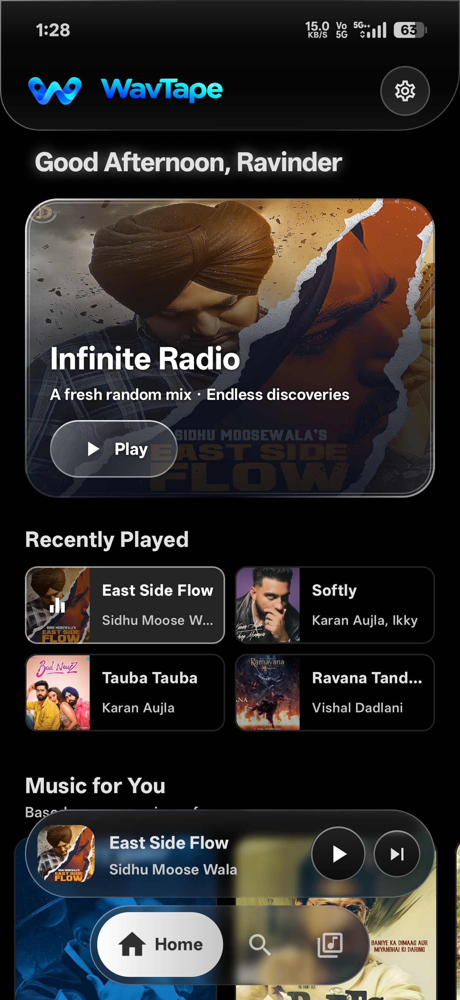
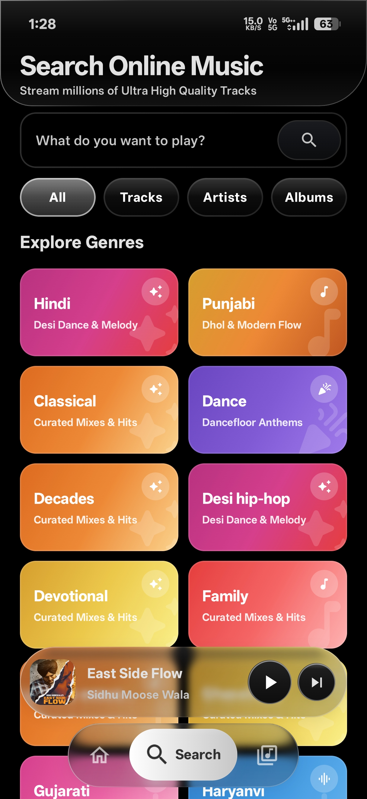
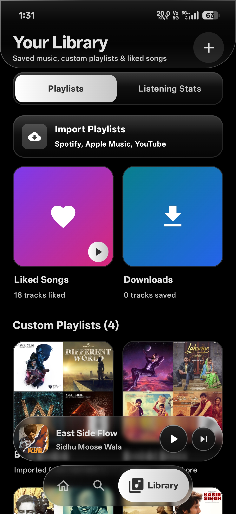
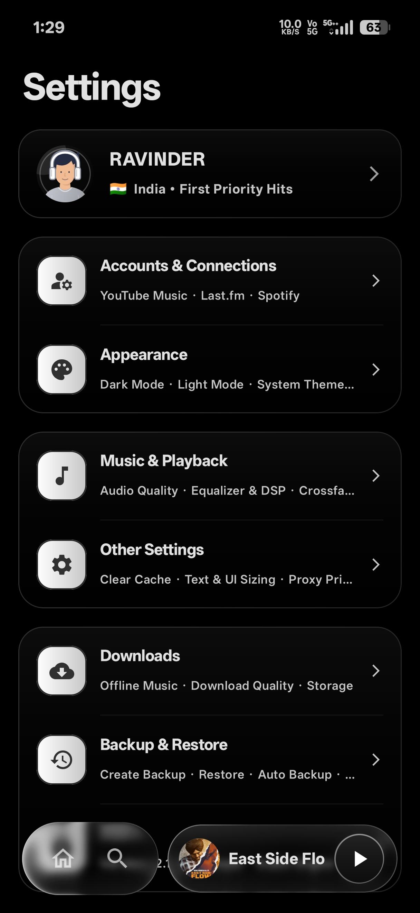

<div align="center">

  <!-- Centered App Logo & Wordmark -->
  <p>
    <a href="https://github.com/rsrathore2196/WavTape">
      
    </a>
    <br />
    <a href="https://github.com/rsrathore2196/WavTape">
      
    </a>
  </p>

  <!-- Short Overview -->
  <p>
    <b>WavTape</b> (formerly known as Xtreme Player) is a lightweight, modern, open-source online streaming YouTube Music Client for Android. Built with a clean Material You (Material 3) interface, it delivers an ad-free, high-fidelity listening experience with studio-grade lossless audio support and extensive customization.
  </p>
  <p>
    Stream millions of online tracks in studio-grade <b>Lossless and FLAC high-res audio</b>, manage custom libraries, and enjoy seamless playback without interruptions.
  </p>

  <!-- Badges -->
  <p>
    <a href="https://github.com/rsrathore2196/WavTape/releases"></a>
    <a href="https://github.com/rsrathore2196/WavTape/releases/latest"></a>
    <a href="#"></a>
  </p>

  <p>
    <a href="https://t.me/WavTapeOfficial"></a>
    <a href="https://t.me/WavTapeDiscussion"></a>
  </p>

  <p>
    <a href="https://buymeachai.ezee.li/RSRathore"></a>
  </p>

  <!-- Quick Navigation -->
  <p>
    <a href="#-app-interface">App Interface</a> •
    <a href="#-key-features">Key Features</a> •
    <a href="#-built-with">Built With</a> •
    <a href="#-getting-started">Getting Started</a>
  </p>

</div>

---

## 📸 App Interface

<div align="center">
  <table>
    <tr>
      <td align="center" width="25%">
        <br />
        <b>Home View</b>
      </td>
      <td align="center" width="25%">
        <br />
        <b>Now Playing</b>
      </td>
      <td align="center" width="25%">
        <br />
        <b>Synced Lyrics</b>
      </td>
      <td align="center" width="25%">
        <br />
        <b>Music Search</b>
      </td>
    </tr>
    <tr>
      <td align="center" width="25%">
        <br />
        <b>Your Library</b>
      </td>
      <td align="center" width="25%">
        <br />
        <b>Settings Hub</b>
      </td>
      <td align="center" width="25%">
        <br />
        <b>Themes & UI</b>
      </td>
      <td align="center" width="25%">
        <br />
        <b>Audio & DSP</b>
      </td>
    </tr>
  </table>
</div>

---

## ✨ Key Features

### 🎧 Premium Streaming & Audio Engine
- **Hi-Res Lossless & HQ Listening:** Enjoy FLAC, WAV, AAC, and bitrate tiers up to 24-bit/192 kHz studio master quality, with adjustable audio quality settings for mobile or high-fidelity listening.
- **Custom Add-ons for Hi-Res Lossless:** Extend studio-quality and Hi-Res Lossless playback with Custom Add-ons support.
- **Dolby Atmos & Spatial Audio:** Experience immersive Dolby Atmos and Spatial Audio with enhanced output precision on compatible devices.
- **Audio DSP & Equalizer:** Tune playback with a 5-band hardware equalizer, preset modes including Flat, Bass Boost, Studio Master, Vocal Enhance, Electronic, Rock, and Acoustic, plus Crystal Clarity and bass enhancement processing.
- **Audiophile Audio Pipeline:** Inspect detailed playback source, audio quality, and output precision insights directly inside the player.
- **Gapless, Smooth Playback:** Gapless transitions, 16-bit PCM hardware output, predictive pre-buffering, and a local LRU cache help reduce stutter and lag on weaker connections.
- **Seamless Crossfade:** Smoothly blend transitions between consecutive tracks for a natural, uninterrupted listening flow.
- **Reimagined Synced Lyrics:** Follow smoothly animated, multilingual lyrics with **Lyrics Translation & Romanization**, **Custom Lyrics Offset Adjustment**, **Adjustable Lyrics Text Size**, and **Custom `.LRC` Lyrics Import**.
- **Background & Controls:** Persistent lock screen and notification playback controls keep music playing in the background with AndroidX Media3 support.
- **Smart Recommendations:** Discover more relevant tracks, regional chart hits, personalized mixes, and artist-based suggestions without repetitive country tags.
- **Fresh Genre Discovery:** Shuffle through curated genre sessions with better track rotation and new recommendations every time you open a section.

### 🎨 Material You Interface & Customization
- **Modern Material 3 UI:** Clean, glass-inspired layouts with dynamic AMOLED dark mode, light mode, or system theme matching.
- **Liquid Glass Design & Adaptive Themes:** Translucent, adaptive Liquid Glass surfaces and refined visual depth harmonized with improved adaptive Material Design theming across the entire app.
- **Full-Screen Album Art & Immersive Player:** Adaptive player backgrounds with full-screen album art support for a richer, more immersive Now Playing experience.
- **Fluid Motion & Smooth Transitions:** Refined screen transitions and responsive animations crafted for natural, effortless navigation across Android devices.
- **Custom Themes & Colors:** Choose from 10 curated presets and fine-tune accent, canvas, card, and gradient colors with live visual changes.
- **Player UX & Visuals:** Ambient album glow, dynamic blur/liquid glass effects, high-contrast typography, full-screen player polish, and tactile haptic feedback.
- **Text & Layout Controls:** Adjust text size, UI density, theme mode, and mini-player actions like the favorite heart and next-track control.
- **Adaptive Personalization:** Save your preferred playback and visual settings for a consistent, tailored listening experience.

### 🔍 Search, Library & Discovery
- **Instant Online Search:** Search tracks, artists, albums, and top hits with a fast, debounced engine.
- **Offline Downloads:** Download your favorite tracks for uninterrupted offline listening anytime, without depending on an active internet connection.
- **Connected Music Accounts (YouTube, Spotify & Last.fm):** Link your **YouTube**, **Spotify**, and **Last.fm** accounts for **Two-Way Playlist Sync**, **Two-Way Liked Songs Sync**, and **Music Scrobbling**.
- **Listening Stats & Shareable Highlights:** Visualize your listening journey with **Weekly**, **Monthly**, and **Lifetime** insights, plus shareable Listening Stats highlights.
- **Enhanced Artist Profiles:** Explore dedicated artist pages synced directly with YouTube Music artist accounts and profiles.
- **Personalized Library:** Save favorites, track listening history, revisit recently played music, and follow most-listened artists and curated recommendations.
- **Playlists & Queue:** Create and manage playlists, reorder tracks, shuffle, loop, and resume playback without interruption.
- **Import from Other Services:** Import playlists from Spotify, Apple Music, Amazon Music, and custom local music sources.
- **Home & Discovery Cards:** Explore trending tracks, personalized mixes, country/language recommendations, and inspired song sections from the Home screen.

### 🧰 Smart Settings, Backup & Privacy
- **Performance Profiles & 120 Hz Support:** Choose dedicated performance profiles with adaptive refresh-rate support up to **120 Hz** on compatible devices and broad Android compatibility including Android 17.
- **Smart Storage & Cache:** Clear cache, smart auto-trim, configure cache quotas, and run one-tap optimization to keep storage under control.
- **Backup & Restore:** Create backups of playlists, library entries, and preferences, restore them from phone storage, and automate backups to a chosen folder.
- **Privacy & Proxy Controls:** Use proxy settings and privacy-conscious preferences without invasive tracking or unnecessary permissions.
- **Accessibility & Comfort:** Scale text and app density to fit your screen and preference, with extra UI personalization and haptic feedback.

### 🔓 100% Free & Open Source
- **No Ads, No Paywalls:** Pure music streaming without sponsored interruptions.
- **No Subscription Lock-in:** Full access to the app without monthly fees or premium gates.
- **Privacy-First Design:** No invasive tracking, profiling, or unnecessary permissions.
- **Community-Driven:** Fully open-source codebase open for contributions and audits.

---

## 🛠 Built With

- **Language:** Kotlin
- **UI Toolkit:** Jetpack Compose & Material Design 3
- **Audio Engine:** AndroidX Media3 (ExoPlayer + MediaSessionService)
- **Architecture:** Clean Architecture + MVI / MVVM
- **Database:** Room (Local playlists and metadata caching)
- **Image Loading:** Coil Compose
- **Networking:** Retrofit2 & OkHttp3

---

### Prerequisites
- Android Studio Ladybug (2024.2.1 or newer)
- Android SDK Platform 37.0 with the SDK licenses accepted
- JDK 17+

---

## Disclaimer & Legal Notice

WavTape is an independent, community-driven third-party audio player and client. It is not associated with Google LLC, YouTube Music, Telegram, or any of their parent companies.

- **No Media Hosting:** WavTape does not host, upload, or store copyrighted music files. It operates strictly as an interface to scan local device storage or stream media directly from public sources.
- **Fair Use & API Usage:** This software is created solely for personal research, educational, and fair-use purposes. The user is entirely responsible for ensuring their usage aligns with their local laws and the terms of the providers they access.

**This project is provided for educational and research purposes only. The maintainers do not endorse or facilitate copyright infringement, unauthorized redistribution, or illegal access to media.**

### Licence

This project is licensed under the [GNU General Public License v3.0 (GPLv3)](third_party/backdrop/LICENSE-GPL-3.0.txt) and the [Apache License 2.0](third_party/backdrop/LICENSE-APACHE-2.0.txt).

---

### Build & Run

```bash
# Clone the repository
git clone https://github.com/rsrathore2196/WavTape.git

# Navigate to the project directory
cd WavTape

# Build the debug APK
./gradlew :app:assembleDebug
```

---

<div align="center">
  <a href="https://github.com/rsrathore2196/WavTape">
    
  </a>
</div>

